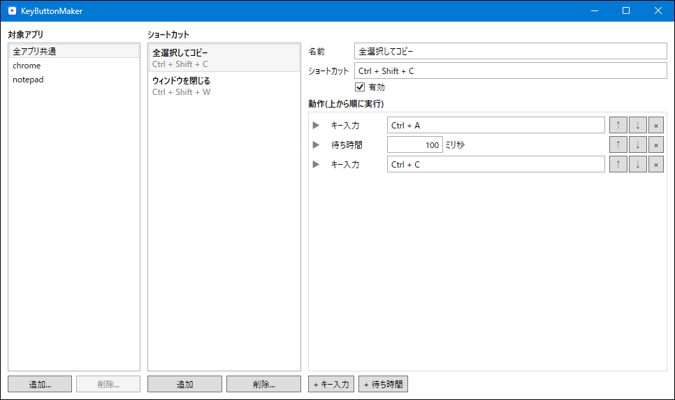

# KeyButtonMaker

アプリごとにショートカットキーを設定し、押したときの動作(キー入力・待ち時間の組み合わせ)を作成できるツールです。タスクトレイに常駐して動作します。WPF(.NET 10)製。

## 機能

- **対象アプリ** — プロセス名(例: `chrome`)でアプリを指定し、アプリごとにショートカットを登録します  
「追加...」で開くウインドウから実行中のアプリを選ぶか、プロセス名を直接入力します
  - **全アプリ共通** — どのアプリでも有効なショートカットを登録できます(削除不可)
  - 同じショートカットがある場合は、アプリ専用の設定が全アプリ共通より優先されます
- **ショートカット** — Ctrl / Shift / Alt / Win との組み合わせに対応。入力欄をクリックしてキーを押すだけで割り当てられます  
ショートカットごとに有効 / 無効を切り替えられます
- **動作** — 上から順に実行する手順を自由に組み立てられます
  - **キー入力** — 修飾キー込みのキーを 1 回押して離します(例: `Ctrl + C`)
  - **待ち時間** — ミリ秒単位で待機します
  - 「↑」「↓」で並び替え、「×」で削除
- **判定対象** — 最前面(アクティブ)のウインドウのアプリで判定します  
ショートカットのキー入力は元のアプリには渡りません
- **タスクトレイ常駐** — ウインドウを閉じてもトレイで動作し続けます。トレイのメニューから一時停止・終了ができます
- **設定の自動保存** — 変更のたびに実行ファイルと同じフォルダの `settings.json` へ保存し、次回起動時に復元します

## 使い方

1. `KeyButtonMaker.exe` を起動します
2. 「対象アプリ」の「追加...」で、ショートカットを使いたいアプリを選びます(すべてのアプリで使う場合は「全アプリ共通」)
3. 「ショートカット」の「追加」でショートカットを作り、ショートカット欄をクリックして割り当てたいキーを押します
4. 「+ キー入力」「+ 待ち時間」で動作の手順を組み立てます
5. 対象アプリ上で割り当てたショートカットを押すと、動作が実行されます

`/tray` を付けて起動すると、ウインドウを表示せずにトレイに常駐した状態で起動します(スタートアップ登録向け)。

## 動作環境

- Windows 10 / 11
- [.NET 10 ランタイム](https://dotnet.microsoft.com/download/dotnet/10.0)(Windows Desktop)

## 注意事項

- 設定ファイル(`settings.json`)は実行ファイルと同じフォルダに保存されます。`Program Files` など書き込み権限のない場所に配置した場合、設定は保存されません
- 管理者権限で動作しているアプリ上では、ショートカットは反応しません(本ツールも管理者として起動すれば動作します)
- 動作の実行中に同じショートカットを押しても、重ねて実行はされません
- 本ツールの使用は自己責任でお願いします。ゲーム等では利用規約により自動操作が禁止されている場合があります

## ライセンス

MIT License
